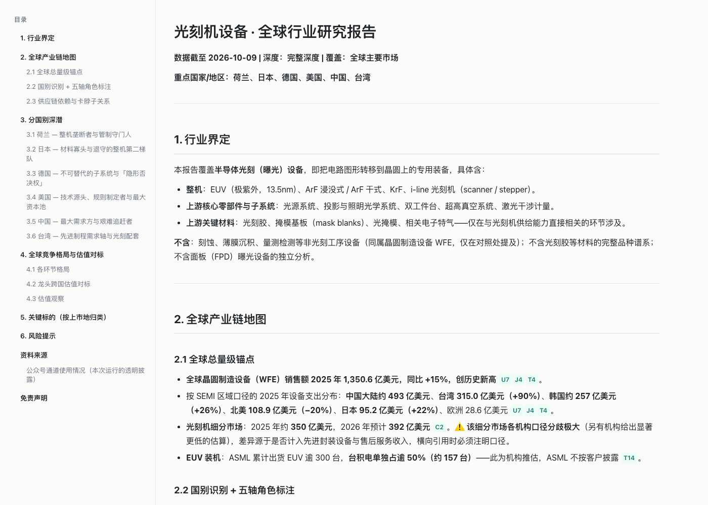

# industry-research

> A set of Claude Code skills: **give it an industry name, get a multi-country industry
> research report with traceable citations — plus a self-contained web page to read it in.**

[中文](README.md) · [Implementation overview](docs/00-实现总览.md) · [Sample report](examples/lithography_深度研报_2026-10-09.md)



*The web version of the [sample report](examples/lithography_深度研报_2026-10-09.html): auto-generated
sidebar TOC on the left, body on the right. Every citation badge (`U7` `J4` `C2`…) is a link that
jumps to the matching entry in the source appendix.*

---

## What it does

Given any industry, it produces a six-section report:

1. **Industry boundary** — what's in scope, what isn't
2. **Global value-chain map** — global size anchor, country identification and roles, supply-chain dependencies
3. **Per-country deep dive** — role, companies, data, valuation, policy, competitive landscape
4. **Global competitive landscape & valuation benchmarking** — cross-country comparison
5. **Key names** — grouped by listing venue
6. **Risk factors**

Plus a source appendix. **Every figure in the body carries an inline citation that maps 1:1 to the appendix.**

---

## Quick start

Requires **Claude Code** and **python3** (standard library only — no third-party packages).

```bash
git clone https://github.com/Xieyuqi001/industry-research.git
cd industry-research
./install.sh
```

`install.sh` copies both skills into `~/.claude/skills/`. If a skill with the same name
already exists it is backed up with a timestamp first — nothing is silently overwritten.

Then, inside Claude Code:

```
Take a look at the solar PV industry
```

It will first ask you two things — **whether you want the full report**, and **market coverage
and depth** — and only start searching once you confirm.

### Just want the HTML converter

`report-html` is industry-agnostic and works on any long Markdown document:

```bash
python3 ~/.claude/skills/report-html/build.py your-document.md
```

It writes a sibling `.html`: a single self-contained file with zero external requests. Works
offline, survives being emailed to someone, and `Cmd+P` / `Ctrl+P` prints straight to PDF.

---

## Design notes

### Judgment stays with the model; discipline is written into the skill

Almost none of the complexity here is "retrieval infrastructure." It's **judgment**: which
figure's methodology is trustworthy, whether a source is real research or an ad, what to do
when two sources give different numbers for the same metric.

So the end state isn't a framework — it's **a workflow and an acceptance checklist encoded as a
skill, executed by a model**. The cost is real: **no determinism.** Run the same industry twice
and you'll get different source counts and different phrasing. What you get in exchange is zero
infrastructure, zero dependencies, and an afternoon's worth of editing to change.

### Retrieval is centralized; sub-agents only read

Sub-agents run in parallel. If each one also searched, they would **simultaneously** trip the
rate limits and CAPTCHA on the WeChat channel, and — unable to see each other — would
inevitably duplicate work.

So retrieval is done serially by the main agent (rate-limiting and circuit-breaking need a single
control point), and sub-agents only read and judge. That split was forced by measurement, not by
taste.

### If self-check fails, nothing is written

Before writing output, `report-html` verifies there are **no dangling citations** (body cites
`[X9]` but the appendix has no such entry), no unconverted Markdown left over, and that the
output is genuinely self-contained. **If any check fails, it writes no file** — it will not hand
you a page that merely *looks* finished while every citation is broken.

The industry report has its own 8-point pre-delivery checklist. The two highest-rework items are
**cross-section consistency** (a figure in the cross-country comparison must not contradict the
same figure in the country chapter) and **citation ↔ appendix 1:1 correspondence**.

---

## Repository layout

```
├── skills/
│   ├── industry-research/SKILL.md   Main workflow: 8 steps + pre-delivery checks
│   └── report-html/                 Markdown → single-file HTML
│       ├── build.py                 Standard-library-only converter
│       └── theme.css                Every style variable lives here
├── docs/                            (Chinese)
│   ├── 00-实现总览.md                Architecture, flow, decisions, risks
│   ├── 01-资料渠道.md                What each retrieval channel can actually do
│   ├── 02-公众号检索通道.md          The WeChat search pipeline + circuit breaking
│   ├── 03-已知边界与坑.md            Pitfalls we already hit — don't re-hit them
│   └── archive/                     Early drafts describing a different, unbuilt architecture
├── examples/                        Two complete sample reports
├── reports/                         Your output directory (gitignored)
└── install.sh
```

The `docs/` are currently Chinese-only. The [implementation overview](docs/00-实现总览.md) is the
one worth translating first if you want to help.

---

## Known limitations

This works. It is not *reliable*. In the interest of not overselling:

| Limitation | Detail |
|---|---|
| Non-deterministic | Same industry twice → different results, varying source counts |
| Requires Claude Code | It's a skill, not a standalone program |
| WeChat channel needs a real browser | **And a CAPTCHA appears once cumulative query volume crosses a threshold** — a human must solve it once |
| **Threshold unknown** | Trigger threshold, window, and whether it's per-IP are **not reproduced**. Only degraded protection is implemented; we do *not* claim this is solved |
| Some sources unreachable | Paid WeChat articles, GBK-encoded finance sites, sites blocked by network |
| Images degrade to links | To guarantee a self-contained file, `` renders as a link |
| Non-Chinese sources skew old | Chinese-language coverage of *foreign* industries is inherently sparse and dated — a supply constraint, not a query-wording problem |

See [Known limitations and pitfalls](docs/03-已知边界与坑.md) (Chinese) for the full list.

---

## Documentation

- [Implementation overview](docs/00-实现总览.md) — architecture, end-to-end flow, settled decisions, v1 scope
- [Retrieval channels](docs/01-资料渠道.md) — what WebSearch / WebFetch / curl / Sogou each can do
- [WeChat search pipeline](docs/02-公众号检索通道.md) — the three-stage chain, fingerprint gate, CAPTCHA and circuit breaking
- [Known limitations and pitfalls](docs/03-已知边界与坑.md) — including three cases where *the verification itself was lying*

---

## License

- [MIT](LICENSE)

> ⚠️ Reports produced by this tool are compiled from public information and **do not constitute
> investment advice**. Check the terms of service and robots policy of any site you scrape.
